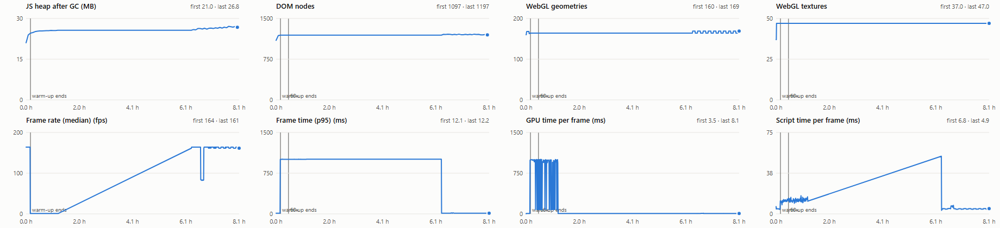

# Soak report: 2026-11-03T19-47-35-1920x1080

**Result: FAIL**

- Commit: 6db047f + uncommitted changes
- Renderer: ANGLE (NVIDIA, NVIDIA GeForce RTX 3050 6GB Laptop GPU (0x000025AC) Direct3D11 vs_5_0 ps_5_0, D3D11)
- Viewport: 1920x1080, device scale 1, display refresh cap (vsync)
- Quality: auto, seed 1
- Schedule: 600 min at 1x, 120 min at 60x; warm-up 10 min
- Started 2026-11-03T19:48:01.654Z, lasted 8.12 h, 349 samples

## Pass criteria

| Check | Value | Result |
|---|---|---|
| Heap slope after warm-up < 5 MB/h | 0.18 MB/h | PASS |
| WebGL geometries flat | 0.37 /h (peak 164 -> 169) | FAIL |
| WebGL textures flat | 0.00 /h (peak 47.0 -> 47.0) | PASS |
| DOM nodes flat | 1.59 /h (peak 1193 -> 1211) | PASS |
| Event listeners flat | 0.03 /h (peak 376 -> 378) | PASS |
| Fps drop < 5 % | -16290 % (1.0 -> 164 fps over 60 min windows) | PASS |
| No tier step after warm-up | 0.00 steps | PASS |
| No errors | 0.00  | PASS |
| No WebGL context lost | 0.00  | PASS |
| No non-local requests | 0.00  | PASS |

## Slopes after warm-up

| Measure | Per hour | First | Last |
|---|---|---|---|
| Heap after GC, MB | 0.18 | 24.6 | 26.8 |
| Heap as sampled, MB | 1.37 | 27.1 | 30.4 |
| Simulator worker heap, MB | n/a | n/a | n/a |
| DOM nodes after GC | 1.59 | 1193 | 1197 |
| Listeners after GC | 0.03 | 375 | 375 |
| Geometries | 0.37 | 164 | 169 |
| Textures | 0.00 | 47.0 | 47.0 |
| Programs | -0.07 | 53.0 | 52.0 |
| Draw calls per frame | 1.05 | 384 | 401 |
| Triangles per frame | -4491 | 1399812 | 1357346 |
| GPU ms per frame | -112 | 998 | 8.1 |
| Script ms per frame | -1.13 | 12.1 | 4.9 |
| Median fps | 23.72 | 1.0 | 161 |
| p95 frame ms | -149 | 1006 | 12.2 |

## By phase

| Phase | Samples | Median fps | Median p95 ms | Median GPU ms | Heap slope MB/h |
|---|---|---|---|---|---|
| 1x | 329 | 161 | 12.2 | 8.0 | 0.18 |

## Collections

| Collection | Retention | Peak | Last |
|---|---|---|---|
| liveStore.bays | site config: 7 bays | 7 | 7 |
| liveStore.bayRxAt | site config: 7 bays | 7 | 7 |
| liveStore.actors | site config: 7 bays (each frame replaces the last) | 7 | 7 |
| liveStore.visits | cap 60, oldest arrival out | 22 | 22 |
| alertStore.events | cap 500, oldest closed first | 360 | 360 |
| alertStore.lifecycleAt | only events held | 344 | 344 |
| alertStore.pending | cap 200 events, oldest out; 8 per event | 0 | 0 |
| alertStore.unreadIds | only events held | 360 | 360 |
| simulator history: events | 8 days, open ones stay (mock only) | 7614 | 7614 |
| simulator history: visits | 8 days, unfinished stay (mock only) | 382 | 382 |
| simulator history: belt intervals | 8 days (mock only) | 3041 | 3041 |
| simulator history: hourly counts | 8 days (mock only) | 591 | 591 |
| simulator history: SKU tallies | 8 days (mock only) | 3021 | 3021 |
| simulator history: day curves | 8 days (mock only) | 8 | 8 |
| simulator history: camera incidents | 8 days, open ones stay (mock only) | 8 | 8 |

## Conditions

- Foreground process per sample: chrome 234, WindowsTerminal 3, claude 112
- Samples with no frame drawn: 0; with the tab not visible: 0
- Tiers seen: med, high; render size: 1920x1031
- Page errors and console errors: 0
- WebGL context lost: 0; non-local requests: 0
- Simulated user: 163 actions, 0 failed (actions.log)

Criteria: heap slope < 5 MB/h after the warm-up (post-GC samples); "flat" means the last third of the run peaks no higher than the first third (DOM and listeners: within 5 %); fps drop < 5 % between the first and the last window.
