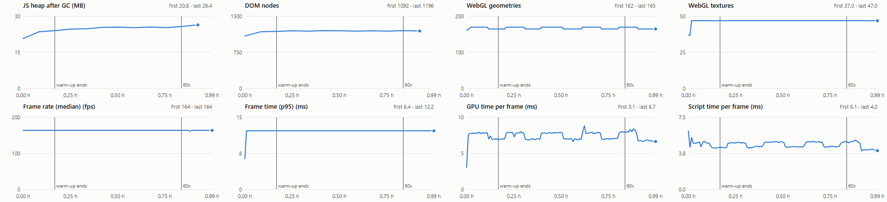

# Soak report: 2026-11-02T20-25-58-1920x1080

**Result: PASS**

- Commit: e21a47c + uncommitted changes
- Renderer: ANGLE (NVIDIA, NVIDIA GeForce RTX 3050 6GB Laptop GPU (0x000025AC) Direct3D11 vs_5_0 ps_5_0, D3D11)
- Viewport: 1920x1080, device scale 1, display refresh cap (vsync)
- Quality: auto, seed 1
- Schedule: 50 min at 1x, 10 min at 60x; warm-up 10 min
- Started 2026-11-02T20:26:21.317Z, lasted 0.99 h, 120 samples

## Pass criteria

| Check | Value | Result |
|---|---|---|
| Heap slope after warm-up < 5 MB/h | 2.28 MB/h | PASS |
| WebGL geometries flat | -1.43 /h (peak 170 -> 170) | PASS |
| WebGL textures flat | 0.00 /h (peak 47.0 -> 47.0) | PASS |
| DOM nodes flat | 5.59 /h (peak 1200 -> 1203) | PASS |
| Event listeners flat | 0.87 /h (peak 371 -> 371) | PASS |
| Fps drop < 5 % | 0.00 % (164 -> 164 fps over 17 min windows) | PASS |
| No tier step after warm-up | 0.00 steps | PASS |
| No errors | 0.00  | PASS |
| No WebGL context lost | 0.00  | PASS |
| No non-local requests | 0.00  | PASS |

## Slopes after warm-up

| Measure | Per hour | First | Last |
|---|---|---|---|
| Heap after GC, MB | 2.28 | 24.1 | 26.4 |
| Heap as sampled, MB | 8.24 | 28.2 | 57.1 |
| Simulator worker heap, MB | n/a | n/a | n/a |
| DOM nodes after GC | 5.59 | 1188 | 1196 |
| Listeners after GC | 0.87 | 371 | 371 |
| Geometries | -1.43 | 165 | 165 |
| Textures | 0.00 | 47.0 | 47.0 |
| Programs | 0.29 | 53.0 | 53.0 |
| Draw calls per frame | -16.28 | 388 | 355 |
| Triangles per frame | -162401 | 1389924 | 1045990 |
| GPU ms per frame | -0.29 | 6.9 | 6.7 |
| Script ms per frame | -0.22 | 4.4 | 4.0 |
| Median fps | -0.13 | 164 | 164 |
| p95 frame ms | 0.00 | 12.2 | 12.2 |

## By phase

| Phase | Samples | Median fps | Median p95 ms | Median GPU ms | Heap slope MB/h |
|---|---|---|---|---|---|
| 1x | 80 | 164 | 12.2 | 7.7 | 2.06 |
| 60x | 20 | 164 | 12.2 | 6.8 | 7.79 |

## Collections

| Collection | Retention | Peak | Last |
|---|---|---|---|
| liveStore.bays | site config: 7 bays | 7 | 7 |
| liveStore.bayRxAt | site config: 7 bays | 7 | 7 |
| liveStore.actors | site config: 7 bays (each frame replaces the last) | 7 | 7 |
| liveStore.visits | cap 60, oldest arrival out | 30 | 30 |
| alertStore.events | cap 500, oldest closed first | 500 | 500 |
| alertStore.lifecycleAt | only events held | 439 | 438 |
| alertStore.pending | cap 200 events, oldest out; 8 per event | 30 | 30 |
| alertStore.unreadIds | only events held | 500 | 500 |
| simulator history: events | 8 days, open ones stay (mock only) | 7815 | 7815 |
| simulator history: visits | 8 days, unfinished stay (mock only) | 390 | 390 |
| simulator history: belt intervals | 8 days (mock only) | 3130 | 3130 |
| simulator history: hourly counts | 8 days (mock only) | 604 | 604 |
| simulator history: SKU tallies | 8 days (mock only) | 3086 | 3086 |
| simulator history: day curves | 8 days (mock only) | 8 | 8 |
| simulator history: camera incidents | 8 days, open ones stay (mock only) | 8 | 8 |

## Conditions

- Foreground process per sample: chrome 120
- Samples with no frame drawn: 0; with the tab not visible: 0
- Tiers seen: med, high; render size: 1920x1031
- Page errors and console errors: 0
- WebGL context lost: 0; non-local requests: 0
- Simulated user: 80 actions, 0 failed (actions.log)

Criteria: heap slope < 5 MB/h after the warm-up (post-GC samples); "flat" means the last third of the run peaks no higher than the first third (DOM and listeners: within 5 %); fps drop < 5 % between the first and the last window.
